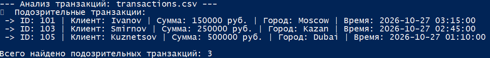

# 🏦 Antifraud Analyzer (Banking Security)

Скрипт на Python для автоматизации первичного мониторинга транзакций и выявления аномалий (признаков мошенничества или компрометации аккаунта) в банковском секторе.

## 🎯 Задача
В банковском ИБ аналитику часто приходится вручную проверять огромные выгрузки транзакций на предмет подозрительных операций. Этот скрипт автоматизирует рутину, экономя время и снижая человеческий фактор.

## ⚙️ Функционал
*   Читает выгрузку транзакций из файла CSV.
*   **Устойчивость к форматам:** Автоматически определяет разделитель (запятая или точка с запятой), что позволяет корректно работать с файлами, сохраненными в русской версии Excel.
*   **Выявление аномалий (Anti-Fraud rules):** Скрипт анализирует каждую операцию и помечает как подозрительные те, что подходят под правило:
    *   Сумма перевода более **100 000 рублей**.
    *   Время совершения операции — **ночное (с 00:00 до 06:00)**.
*   Выводит в список подозрительных транзакций с указанием ID, клиента, суммы, города и времени для дальнейшего расследования.

## 🚀 Запуск
Для работы скрипта необходим установленный Python 3.

python antifraud_analyzer.py

## 📸 Пример работы
На скриншоте ниже видно, как скрипт автоматически отфильтровал безопасные дневные транзакции и выявил три подозрительные ночные операции, которые требуют внимания аналитика SOC.

---
*Проект создан в рамках изучения банковского ИБ и автоматизации задач SOC L1.*
